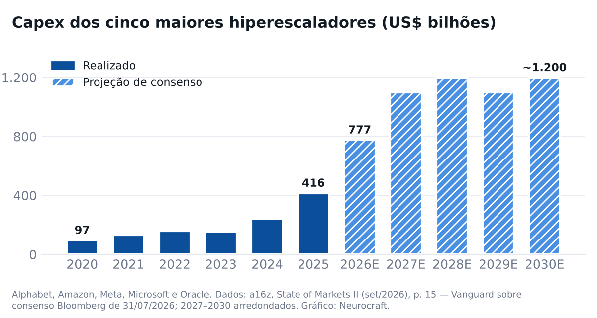
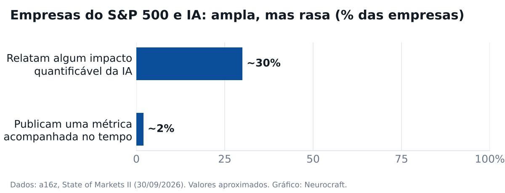
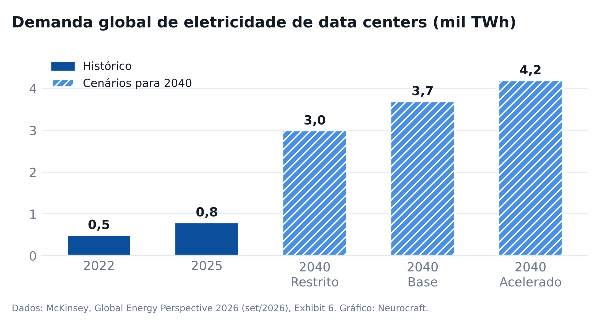

# Newsletter Neurocraft — outubro de 2026

**Assunto:** Outubro: quem paga o piloto, o capex da IA e a energia  
**Preheader:** Os programas de cofinanciamento da Microsoft, os gráficos do State of Markets II e o Global Energy Perspective 2026 da McKinsey.

Esta edição trata de três temas: como a Microsoft cofinancia projetos de dados e IA, o que o State of Markets II, do a16z, mostra sobre capital e adoção, e o que a McKinsey projeta para a energia até 2050.

O mapa resume a leitura; as seções trazem gráficos e fontes.

## O mês em um mapa

**A IA virou infraestrutura — e alguém precisa pagar o piloto**

- **Microsoft**
  - ECIF: a Microsoft paga o parceiro pela prova de conceito
  - Azure Accelerate: verba, créditos e 30+ serviços implantados sem custo
  - FY27: prioridade para Copilot, Fabric e Foundry
- **a16z**
  - Capex de IA: US$ 777 bi em 2026
  - Adoção rasa: ~2% do S&P 500 publica métrica de IA
  - Tecnologia: ~76% do crescimento de lucro do S&P 500
- **McKinsey**
  - Demanda de energia cresceu 2,7% em 2025
  - Data centers: +24% ao ano até 2030
  - A rede é o limite de velocidade

## Microsoft · como cofinanciar o próximo projeto

### ECIF: a Microsoft paga o parceiro pela prova de conceito

O End Customer Investment Funds é verba que o time comercial da Microsoft usa para pagar parceiros em provas de conceito e implantações. A conta é indicada pela própria Microsoft, o parceiro precisa estar cadastrado como fornecedor ECIF e o serviço é pago a preço de mercado. ECIF nunca é desconto de licença.

**E daí:** Para um piloto parado por orçamento, a conversa começa com o executivo de contas da Microsoft. O financiamento costuma vir atrelado a consumo novo de nuvem — entenda a meta antes de assinar.

_Fonte: [Fifty Five and Five](https://fiftyfiveandfive.com/resources/microsoft-ecif-explained/) · 16/10/2026_

### Azure Accelerate: verba, créditos e engenheiros da Microsoft sem custo

O programa reúne financiamento a parceiros, créditos de Azure e o Cloud Accelerate Factory, em que engenheiros da Microsoft implantam mais de 30 serviços do Azure sem custo adicional, com o parceiro. Cobre avaliação, piloto e implantação.

**E daí:** Parte do custo de avaliação e piloto pode sair da conta da Microsoft, se o parceiro tiver a especialização exigida. Pergunte antes de fechar o escopo.

_Fonte: [Microsoft Azure Blog](https://azure.microsoft.com/en-us/blog/introducing-azure-accelerate-fueling-transformation-with-experts-and-investments-across-your-cloud-and-ai-journey/) · 07/07/2025_

### Ano fiscal 2027: incentivos concentrados em Copilot, Fabric e Foundry

Desde julho, a Microsoft reúne incentivos, financiamento e especializações sob o guarda-chuva Frontier Accelerate, com foco em Copilot, Azure AI, Fabric, Foundry, segurança e GitHub. Segundo distribuidores, o Fabric passou a figurar em duas trilhas: plataforma de dados e IA agêntica.

**E daí:** Projetos que unem dado industrial e IA agêntica sobre Fabric estão no centro da prioridade deste ano fiscal. As regras mudam todo julho.

_Fonte: [TD SYNNEX](https://news.tdsynnex.com/amplify/mcaps-microsoft-fy27-partner-strategy/) · 23/07/2026_

## a16z · State of Markets II

### Capex de IA: US$ 777 bilhões em 2026

Alphabet, Amazon, Meta, Microsoft e Oracle devem investir cerca de US$ 777 bilhões em 2026, ante US$ 416 bilhões em 2025, e cerca de US$ 1,1 trilhão por ano a partir de 2027. A demanda por computação segue acima da oferta.

**E daí:** O gargalo da IA saiu do software e foi para o mundo físico: chips, energia e rede. É o mesmo ponto a que a McKinsey chega pelo lado da energia.

_Fonte: [ValuSignal, sobre o deck do a16z (p. 15)](https://www.valusignal.com/blog/a16z-state-of-markets-ii) · 06/10/2026_

## Capex dos cinco maiores hiperescaladores

_Redesenhado pela Neurocraft. Fonte: [a16z, State of Markets II](https://a16z.com/state-of-markets-ii/)_

## a16z · adoção

### Adoção ampla, mas rasa

Cerca de 30% das empresas do S&P 500 relatam algum impacto quantificável da IA, mas só cerca de 2% publicam uma métrica acompanhada ao longo do tempo. No consumo, cerca de 2% dos domicílios americanos pagavam por um serviço de IA em abril.

**E daí:** Para o comprador industrial, importa o segundo número: quase ninguém mede. Projeto de IA sem métrica acompanhada não sobrevive à próxima revisão de orçamento.

_Fonte: [a16z](https://a16z.com/state-of-markets-ii/) · 30/09/2026_

## Empresas do S&P 500 e IA

_Redesenhado pela Neurocraft. Fonte: [a16z, State of Markets II](https://a16z.com/state-of-markets-ii/)_

## McKinsey · Global Energy Perspective 2026

### A transição virou expansão

A demanda global de energia cresceu 2,7% em 2025, com petróleo, gás, carvão e renováveis crescendo ao mesmo tempo. Num dos cenários, o petróleo chega a quase 130 milhões de barris por dia em 2035. Para a McKinsey, não há mais um cenário "mais provável".

**E daí:** Planejar só para um pico precoce do petróleo é uma aposta. O relatório pede que cada empresa defina os sinais que a fariam mudar de rota.

_Fonte: [McKinsey](https://www.mckinsey.com/~/media/mckinsey/industries/energy%20and%20materials/our%20insights/global%20energy%20perspective%202026/global-energy-perspective-2026.pdf) · 30/09/2026_

### IA dos dois lados do sistema elétrico

Data centers são a carga que mais cresce nos mercados da OCDE: 24% ao ano até 2030 no cenário base, com incerteza alta depois. Do lado da oferta, a McKinsey aponta a IA em previsão de rede, manutenção de ativos e engenharia — e trata a rede elétrica como o limite de velocidade do sistema.

**E daí:** A mesma IA que pressiona a rede aparece como ferramenta de manutenção e operação de ativos. O caso de uso que paga a conta já está mapeado.

_Fonte: [McKinsey](https://www.mckinsey.com/~/media/mckinsey/industries/energy%20and%20materials/our%20insights/global%20energy%20perspective%202026/global-energy-perspective-2026.pdf) · 30/09/2026_

### Brasil: suprimento diversificado, custo em alta

A McKinsey classifica o Brasil entre os "independentes diversificados" (pré-sal, a maior base hidrelétrica do G20 e biocombustíveis), mas entre os países em que o custo do sistema elétrico pode crescer mais que o PIB até 2050.

**E daí:** O desafio brasileiro é de custo, não de suprimento. Eficiência operacional vira argumento de política energética, não só de margem.

_Fonte: [McKinsey](https://www.mckinsey.com/~/media/mckinsey/industries/energy%20and%20materials/our%20insights/global%20energy%20perspective%202026/global-energy-perspective-2026.pdf) · 30/09/2026_

## Eletricidade de data centers: histórico e cenários para 2040

_Redesenhado pela Neurocraft. Fonte: [McKinsey, Global Energy Perspective 2026](https://www.mckinsey.com/~/media/mckinsey/industries/energy%20and%20materials/our%20insights/global%20energy%20perspective%202026/global-energy-perspective-2026.pdf)_

## Leitura conjunta · capital, energia e medida

Lidos juntos, os três documentos contam uma história só. O a16z mostra o capital: centenas de bilhões por ano em chips, data centers e energia. A McKinsey mostra a conta física: a rede é o limite de velocidade e a eletricidade de data centers cresce 24% ao ano até 2030. A Microsoft mostra quem paga para a adoção acontecer: ela cofinancia piloto e implantação para que o consumo apareça.

O elo fraco está no meio: só cerca de 2% das empresas do S&P 500 publicam uma métrica de IA acompanhada no tempo. Financiamento resolve o custo do piloto, não a falta de medida.

Antes de pedir verba, duas perguntas internas:

1. Que métrica operacional este projeto vai mover, e quem a acompanha depois da entrega?

2. O consumo de nuvem projetado no escopo cabe no orçamento do ano seguinte, quando o financiamento acabar?

_Fonte: [a16z, State of Markets II](https://a16z.com/state-of-markets-ii/)_
_Fonte: [McKinsey, Global Energy Perspective 2026](https://www.mckinsey.com/~/media/mckinsey/industries/energy%20and%20materials/our%20insights/global%20energy%20perspective%202026/global-energy-perspective-2026.pdf)_
_Fonte: [Fifty Five and Five — ECIF](https://fiftyfiveandfive.com/resources/microsoft-ecif-explained/)_

## Números do mês

- **~76%** — participação da tecnologia no crescimento de lucro do S&P 500 em 2026

_Fonte: [a16z](https://a16z.com/state-of-markets-ii/)_

- **24% a.a.** — crescimento projetado da eletricidade de data centers até 2030 (cenário base)

_Fonte: [McKinsey](https://www.mckinsey.com/~/media/mckinsey/industries/energy%20and%20materials/our%20insights/global%20energy%20perspective%202026/global-energy-perspective-2026.pdf)_

- **US$ 970 bi** — investimento anual em transmissão e distribuição em 2050, ante US$ 443 bi em 2025

_Fonte: [McKinsey](https://www.mckinsey.com/~/media/mckinsey/industries/energy%20and%20materials/our%20insights/global%20energy%20perspective%202026/global-energy-perspective-2026.pdf)_

---

**[Avaliar o enquadramento do seu projeto nos programas da Microsoft](https://neurocraft.ai/)**

---

## Cortes (não vai no e-mail)

- **neurocraft** — Decisão de Guilherme Cleffe (05/11/2026): outubro fala apenas de cofinanciamento da Microsoft, State of Markets II e Global Energy Perspective 2026. Marca aparece só como anfitriã.
- **bizmetric** — Decisão de Guilherme Cleffe (05/11/2026). Não houve apuração da marca.
- **vexta** — Decisão de 05/11/2026; além disso, sob veto até liberação (config/vetos.json).
- **datamint** — Decisão de 05/11/2026; além disso, sob veto de nome (config/vetos.json).
- **AI Business Process Vouchers: até US$ 100 mil para implantar Dynamics 365 e Power Platform (FY27)** — Fonte primária da Microsoft, mas fora do perfil do leitor (aplicações de negócio, segmento SMC; não combina com ECIF). Cortado pelo formato curto.
- **Fabric em duas trilhas de financiamento no FY27, até US$ 131.250 para parceiros especializados** — Valores de distribuidor, não da Microsoft. A existência das duas trilhas entrou no item do FY27; o valor ficou de fora.
- **SaaS-Prove-It: ~75% do software listado é lucrativo, ~30% cresce acima de 20%** — Relevante para investidor, pouco para o comprador industrial. Cortado pelo formato curto.
